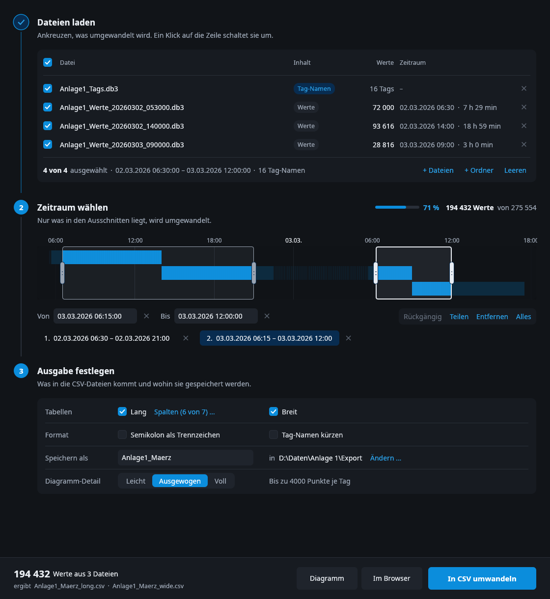
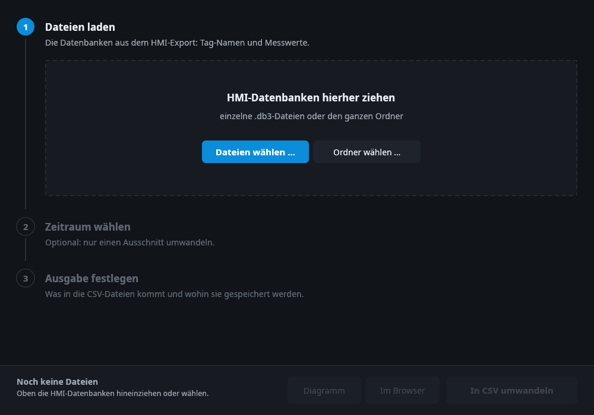
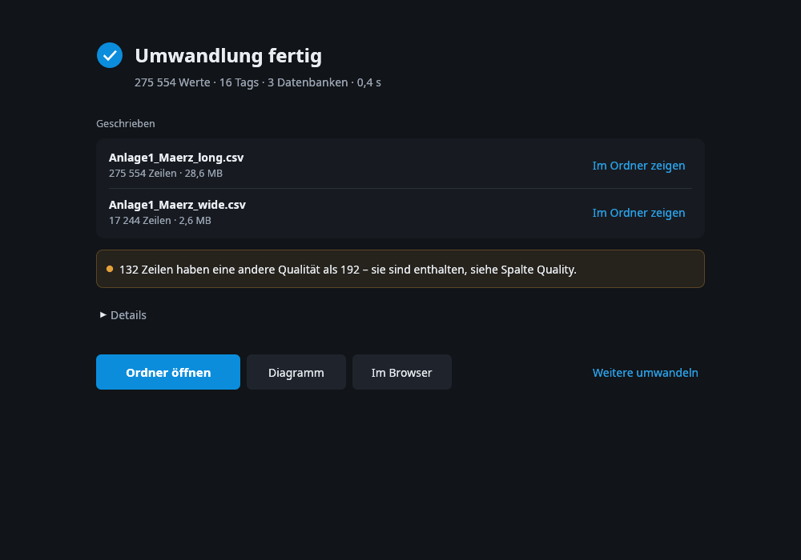
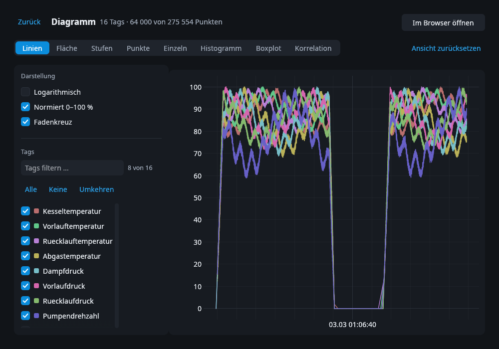
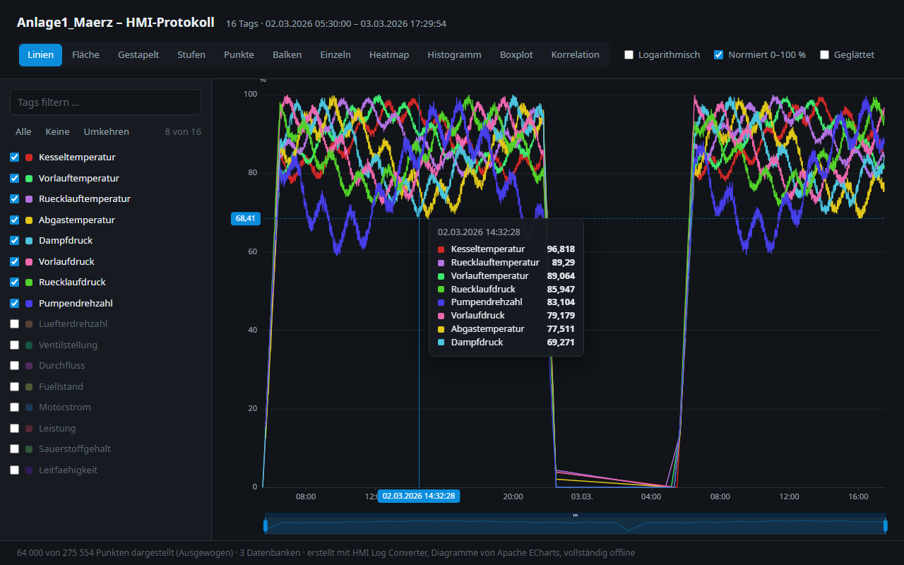

[English](README.md) · **Deutsch**

# HMI Log Converter

Wandelt die Protokolldateien eines WinCC-HMI-Panels in CSV um.
Zeigt die Werte in einem Diagramm.

| Start | Fertig |
| --- | --- |
|  |  |
| **Diagramm im Fenster** | **Diagramm im Browser** |
|  |  |

## Was es macht

- Es liest die `.db3`-Protokolldateien des HMI.
- Es schreibt die Werte in CSV-Dateien. Sie können sie in Excel öffnen.
- Es zeigt die Werte in einem Diagramm.
- Es verändert Ihre Dateien nicht.
- Es braucht kein Internet.
- Sie müssen nichts installieren.

## Herunterladen

1. Öffnen Sie [Releases](../../releases/latest).
2. Laden Sie die Datei für Ihren Computer:
   - Windows: `hmi-converter-…-windows-x86_64.exe`
   - Linux: `hmi-converter-…-linux-x86_64.tar.gz`
3. Starten Sie das Programm.

Windows kann eine Warnung zeigen, weil das Programm nicht signiert ist.
Klicken Sie auf **Weitere Informationen** und dann auf **Trotzdem ausführen**.

## So geht es

Die Schritte im Fenster haben Nummern.

1. **Dateien laden** — ziehen Sie die `.db3`-Dateien in das Fenster.
   Sie können auch den ganzen Ordner ziehen.
2. **Zeitraum wählen** — dieser Schritt ist freiwillig.
   Ziehen Sie über die Leiste, um einen Teil des Protokolls zu wählen.
3. **Ausgabe festlegen** — wählen Sie die Tabellen und den Ordner.
4. Klicken Sie auf **In CSV umwandeln**.

Für ein Diagramm klicken Sie auf **Diagramm** (im Fenster)
oder **Im Browser** (in Ihrem Webbrowser).

## Die CSV-Dateien

Sie bekommen zwei Dateien:

- **long** — eine Zeile für jeden Wert.
- **wide** — eine Zeile für jeden Zeitpunkt, eine Spalte für jeden Tag.

Alle Zeiten sind in UTC.

## Lizenz

MIT — siehe [LICENSE](LICENSE).

Die Diagramme nutzen [Apache ECharts](https://echarts.apache.org) (Apache 2.0).
Die Schrift ist Noto Sans (SIL Open Font License).
