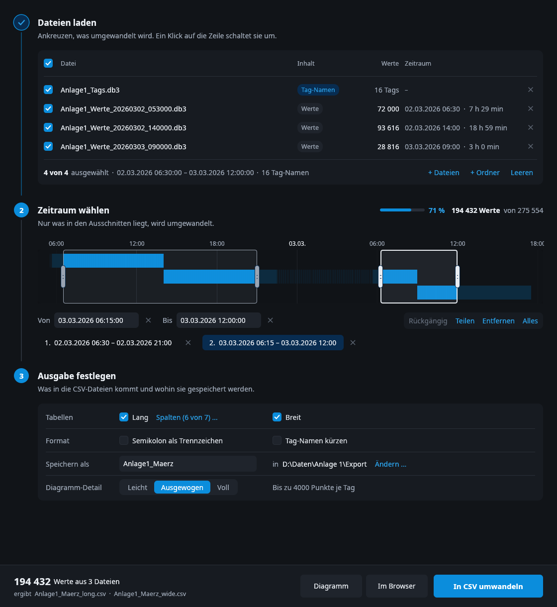
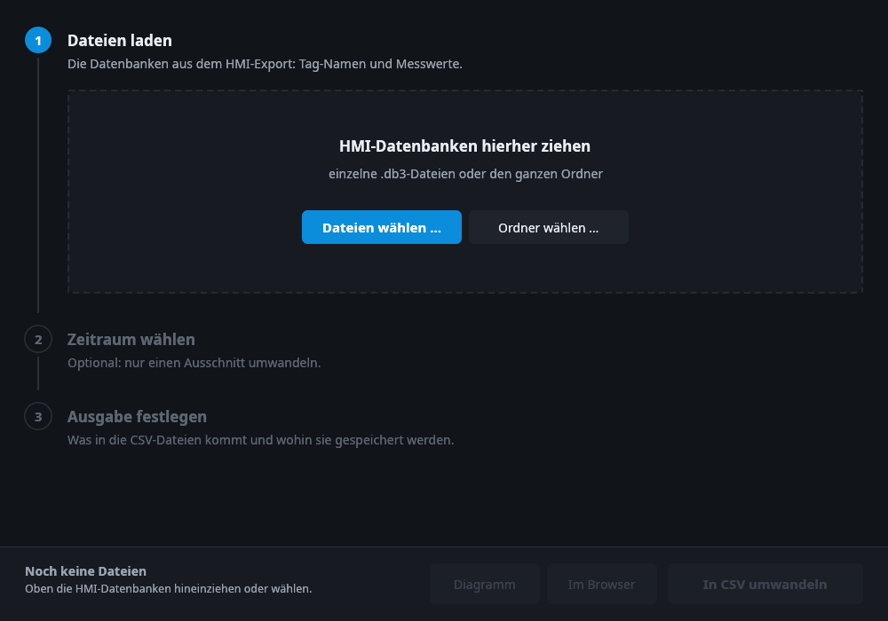
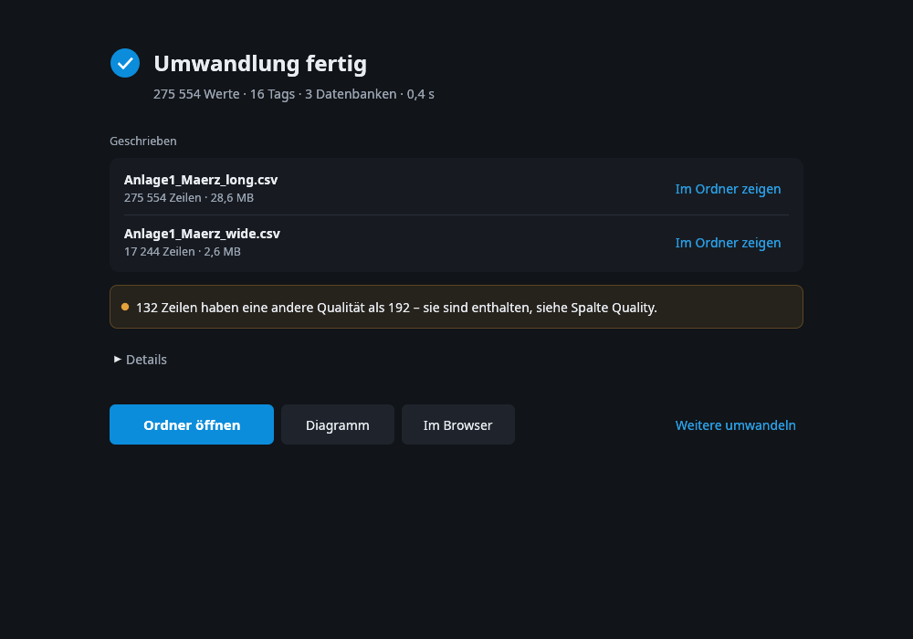
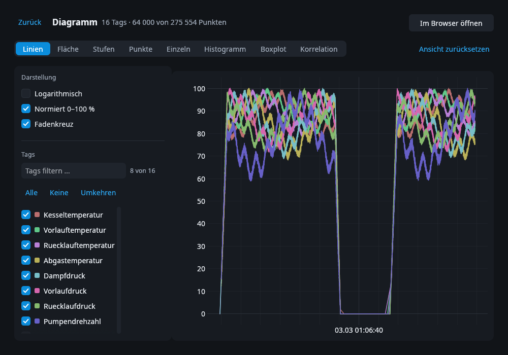
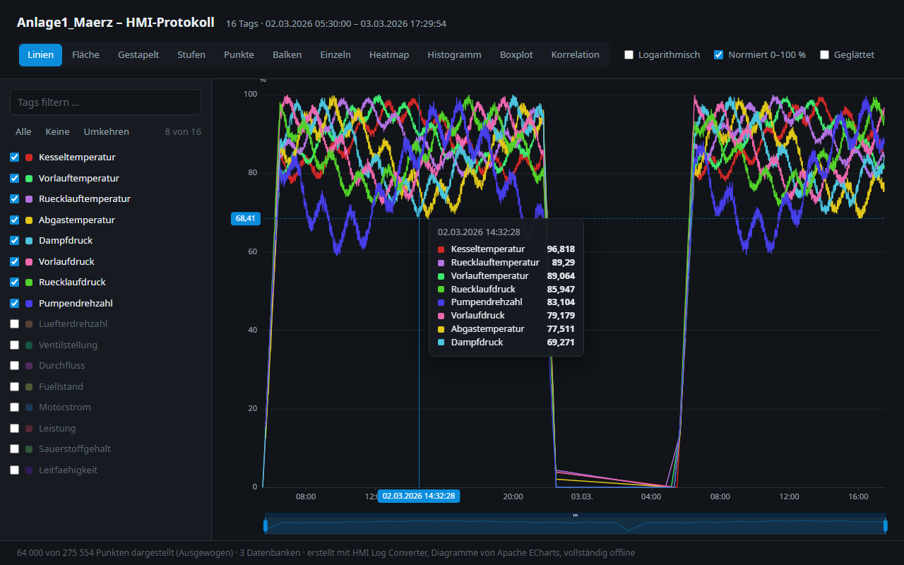

**English** · [Deutsch](README.de.md) · [Русский](README.ru.md)

# HMI Log Converter

Convert the log files of a WinCC HMI panel to CSV.
See the values in a chart.

| Start | Done |
| --- | --- |
|  |  |
| **Chart in the window** | **Chart in the browser** |
|  |  |

## What it does

- It reads the `.db3` log files from the HMI.
- It writes the values to CSV files. You can open them in Excel.
- It shows the values in a chart.
- It does not change your files.
- It does not use the internet.
- It is one file. It needs no other software.

## Download

1. Open [Releases](../../releases/latest).
2. Download the file for your computer:
   - Windows: `hmi-converter-…-windows-x86_64.exe`
   - Linux: `hmi-converter-…-linux-x86_64.tar.gz`
3. Start the program.

Windows can show a warning, because the program has no signature.
Click **More info**, then **Run anyway**.

## How to use

The program speaks German. The steps have numbers.

1. **Dateien laden** (load files) — drag the `.db3` files into the window.
   You can also drag the full folder.
2. **Zeitraum wählen** (select time) — this step is optional.
   Drag across the bar to select a part of the log.
3. **Ausgabe festlegen** (set output) — select the tables and the folder.
4. Click **In CSV umwandeln** (convert to CSV).

To see a chart, click **Diagramm** (in the window)
or **Im Browser** (in your web browser).

## The CSV files

You get two files:

- **long** — one row for each value.
- **wide** — one row for each time, one column for each tag.

All times are UTC.

## License

MIT — see [LICENSE](LICENSE).

The charts use [Apache ECharts](https://echarts.apache.org) (Apache 2.0).
The font is Noto Sans (SIL Open Font License).

## Search words

This program helps when:

- TIA Portal or WinCC Unified exports only one `.db3` log file to CSV at a time.
- The HMI writes a new log file every few hours, and you need all of them in one table.
- You want the values of a tag logging (data log) in Excel.

Keywords: Siemens, TIA Portal, WinCC Unified, Unified Comfort Panel, HMI, SCADA,
tag logging, data logging, data log, log database, `.db3`, SQLite,
`LoggedProcessValue`, `LoggingTag`, merge log files, CSV export, Excel.

This project is not made by Siemens and is not connected to Siemens.
