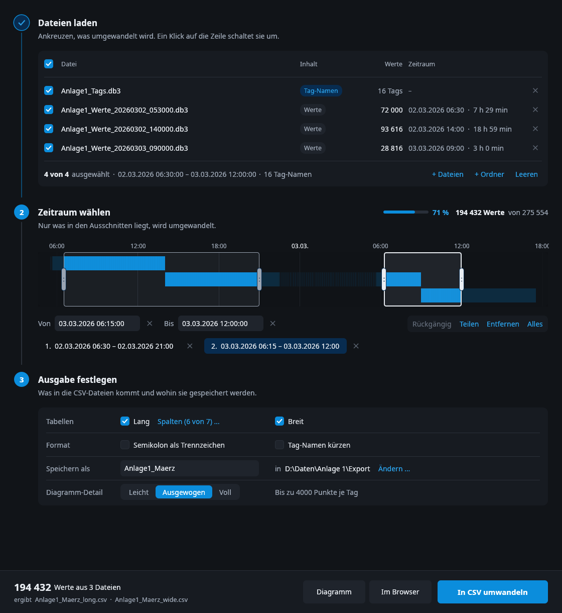
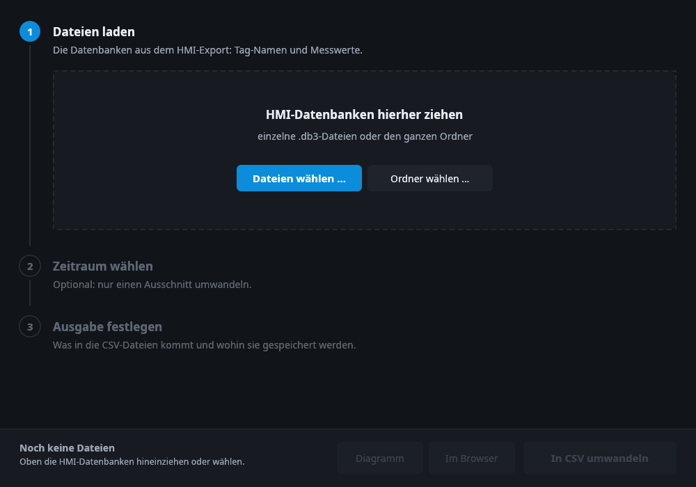
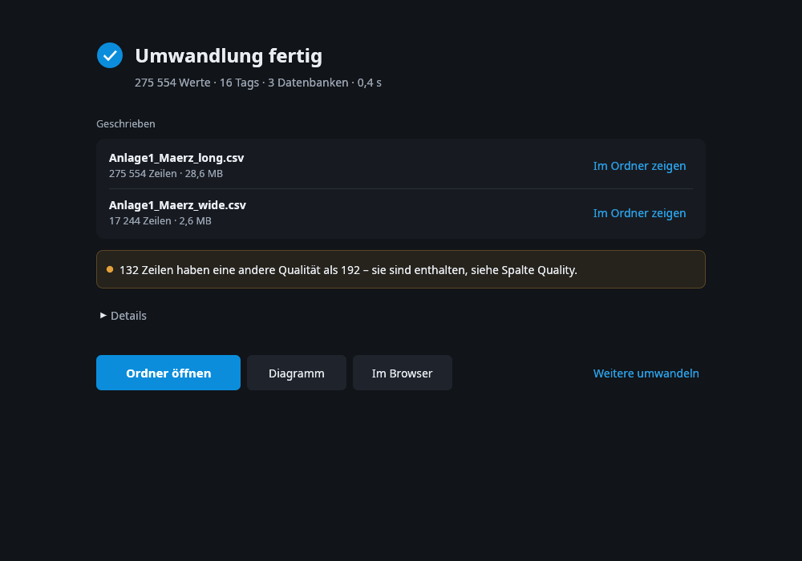
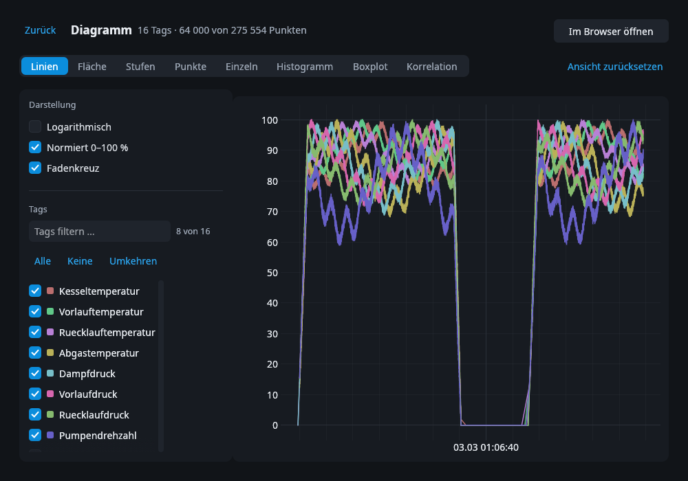
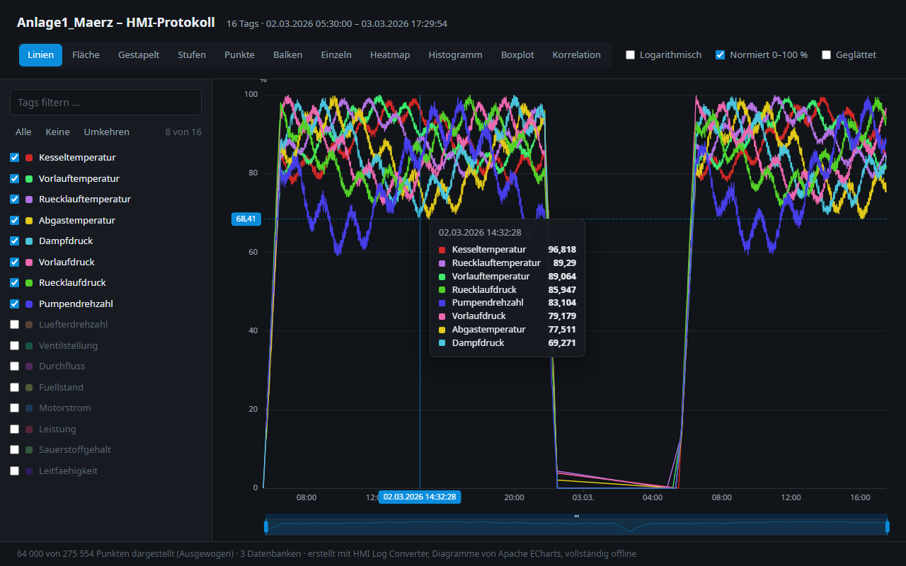

[English](README.md) · [Deutsch](README.de.md) · **Русский**

# HMI Log Converter

Преобразует файлы журнала панели WinCC HMI в CSV.
Показывает значения на графике.

| Старт | Готово |
| --- | --- |
|  |  |
| **График в окне** | **График в браузере** |
|  |  |

## Что делает программа

- Читает файлы журнала `.db3` с HMI.
- Записывает значения в файлы CSV. Их можно открыть в Excel.
- Показывает значения на графике.
- Не изменяет ваши файлы.
- Не использует интернет.
- Это один файл. Другие программы не нужны.

## Скачать

1. Откройте [Releases](../../releases/latest).
2. Скачайте файл для вашего компьютера:
   - Windows: `hmi-converter-…-windows-x86_64.exe`
   - Linux: `hmi-converter-…-linux-x86_64.tar.gz`
3. Запустите программу.

Windows может показать предупреждение, потому что у программы нет подписи.
Нажмите **Подробнее**, затем **Выполнить в любом случае**.

## Как пользоваться

Окно программы на немецком языке. Шаги пронумерованы.

1. **Dateien laden** (загрузить файлы) — перетащите файлы `.db3` в окно.
   Можно перетащить и всю папку.
2. **Zeitraum wählen** (выбрать период) — этот шаг не обязателен.
   Проведите мышью по полосе, чтобы выбрать часть журнала.
3. **Ausgabe festlegen** (задать результат) — выберите таблицы и папку.
4. Нажмите **In CSV umwandeln** (преобразовать в CSV).

Чтобы увидеть график, нажмите **Diagramm** (в окне)
или **Im Browser** (в браузере).

## Файлы CSV

Вы получите два файла:

- **long** — одна строка на каждое значение.
- **wide** — одна строка на каждый момент времени, один столбец на каждый тег.

Всё время указано в UTC.

## Лицензия

MIT — см. [LICENSE](LICENSE).

Графики сделаны с [Apache ECharts](https://echarts.apache.org) (Apache 2.0).
Шрифт — Noto Sans (SIL Open Font License).

## Ключевые слова

Программа помогает, если:

- TIA Portal или WinCC Unified экспортирует в CSV только один файл журнала `.db3` за раз.
- HMI каждые несколько часов пишет новый файл журнала, а нужны все в одной таблице.
- Нужно открыть значения архива тегов (журнала данных) в Excel.

Ключевые слова: Siemens, TIA Portal, WinCC Unified, Unified Comfort Panel, HMI, SCADA,
архив тегов, архивирование тегов, журнал данных, база данных журнала, `.db3`, SQLite,
`LoggedProcessValue`, `LoggingTag`, объединить файлы журнала, экспорт в CSV, Excel.

Этот проект сделан не Siemens и никак не связан с Siemens.
